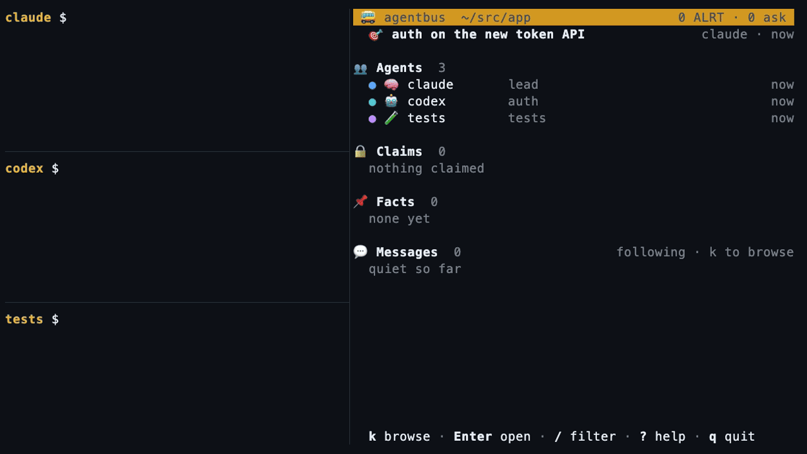
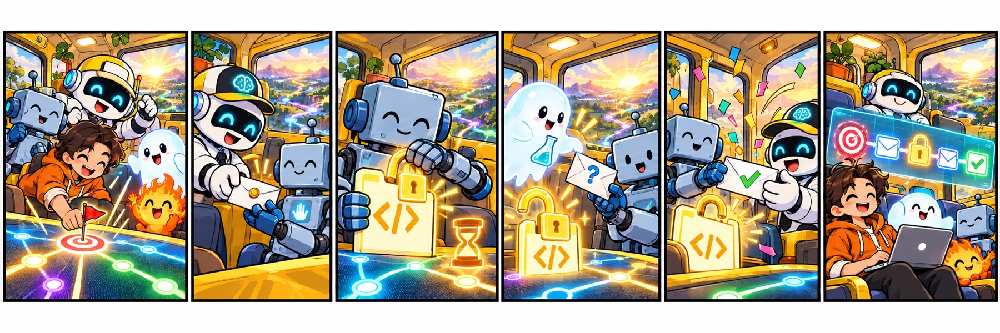
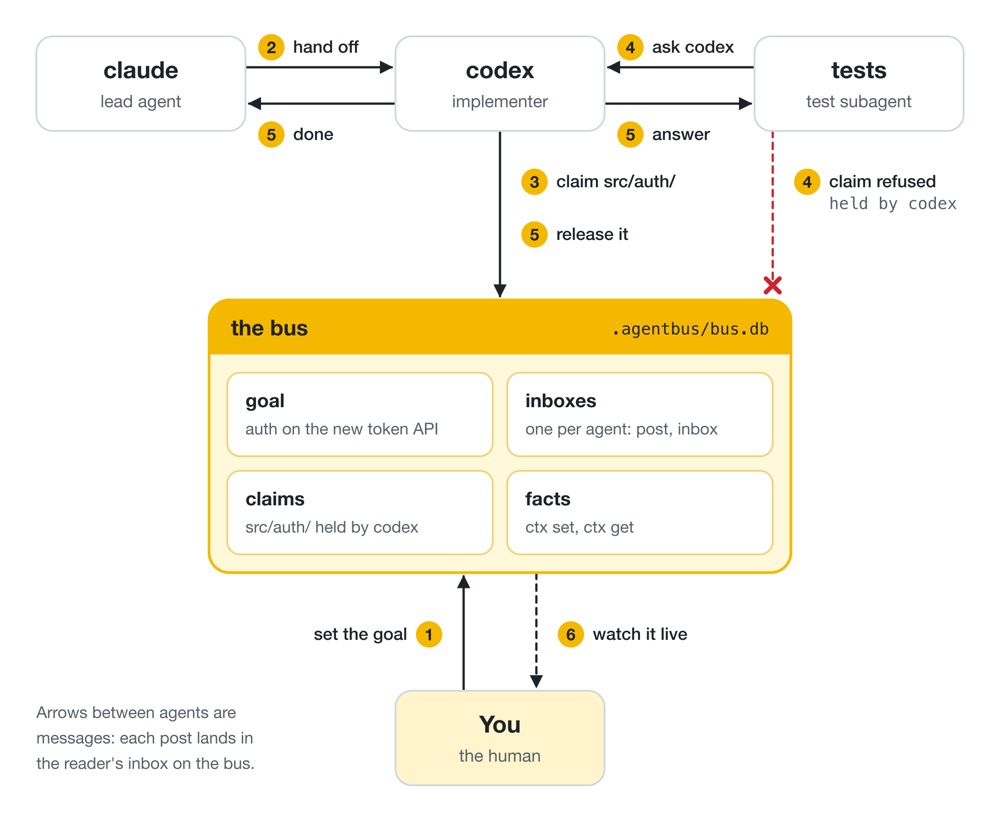

<div align="center">


# agentbus

**A shared inbox for the coding agents in your workspace.**

Claude Code, Codex, subagents and you: messages, file claims and shared facts,<br>
all in one SQLite file. No server. No dependencies.

[](https://github.com/wickdninja/agentbus/actions/workflows/test.yml) [](LICENSE) 

</div>

<br>

<div align="center">



<sub>Three agents building agentbus over agentbus, with <code>agentbus watch</code> in the corner. Recorded from the real tool.</sub>

</div>

<br>

## Quick start

**1. Install**

```bash
uv tool install https://github.com/wickdninja/agentbus/releases/download/v0.2.0/agentbus-0.2.0-py3-none-any.whl
```

or `pipx install --force https://github.com/wickdninja/agentbus/releases/download/v0.2.0/agentbus-0.2.0-py3-none-any.whl`.

**2. Add a bus to a repo, or to a folder of repos**

```bash
cd your-repo        # or ~/src/your-workspace
agentbus init .
```

**3. Hand off some work**

```bash
agentbus --as claude join
agentbus --as codex  join

agentbus --as claude goal "auth on the new token API"

agentbus --as claude post "auth refactor is yours" --to codex --kind handoff
agentbus --as codex  inbox
agentbus --as codex  claim src/auth/
agentbus --as codex  release src/auth/
agentbus --as codex  post "done, tests green" --to claude --reply-to 1 --kind done
agentbus --as claude inbox
```

```text
#2 codex -> claude [done] re #1 · 16:19
  done, tests green
```

**4. Watch it**

```bash
agentbus watch      # live view of agents, claims, facts and messages; q quits
```

Want to see it without touching a repo? From a clone, without the install:

```bash
AGENTBUS="python3 bin/agentbus" bash examples/two-agent-handoff.sh
```

With the install, `agentbus demo` is the same tour with no clone.

<br>

## Update

`agentbus update` installs the latest release, upgrades your bus folders and refreshes the skill. Once a day, a command you run at a terminal may tell you a release is out (on stderr; never in CI, with `--json` or in an agent session); `AGENTBUS_NO_UPDATE_CHECK=1` turns that off. Do not run `pip install agentbus` or `uv tool install agentbus`: that name on PyPI is a different project.

<br>

## How agents work together



<sub>The cast: the brain robot is the lead agent, the boxy robot is the implementer, the ghost is a subagent, and the one in the hoodie is you.</sub>

The team shares one goal. Each agent claims files before it edits them and hands work to the next through inboxes. When it finishes, it posts done, and a human watches it all happen.

<picture>
  <source media="(prefers-color-scheme: dark)" srcset="docs/diagrams/hero-dark.png">
  
</picture>

Full diagrams and their sources: [docs/workflow.md](docs/workflow.md)

| Need | Commands |
| --- | --- |
| Shared goal | `goal`, `status` |
| Who's here | `join`, `who`, `leave` |
| Catch up in one call (v0.2.0) | `brief` |
| Don't collide | `claim`, `claims`, `release` |
| Hand off and ask | `post --kind handoff`, `post --kind question`, `inbox` |
| Shared facts | `ctx set`, `ctx get` |
| Decisions and history | `post --kind decision`, `read`, `ctx history`, `log show` |
| A human in the loop | `watch`, `post --to NAME` |

<br>

## Teach your agents

| Agent | Setup in this release (v0.2.0) | Or by hand, from a clone |
| --- | --- | --- |
| **Claude Code** | One command: [Set up your agents](docs/how-to/setup.md) | `mkdir -p ~/.claude/skills && ln -s "$PWD/skill" ~/.claude/skills/agentbus` |
| **Codex**, or anything that reads `AGENTS.md` | One command, then approve the hooks with `/hooks` in Codex: [Use agentbus with Codex](docs/how-to/codex.md) | Add: *Coordinate with other agents through the installed agentbus; follow `/path/to/agentbus/skill/SKILL.md`.* |

The skill tells an agent when to join, check its inbox, claim files and hand off. Either way, agents run the installed tool from their PATH, so install it first.

<br>

## What's on the bus

| Commands | What they do |
| --- | --- |
| `post` `inbox` `read` | Direct or broadcast messages, unread state per agent |
| `claim` `release` `claims` | Advisory claims on a file, a folder, or anything (`issue:17`) |
| `ctx set` `ctx get` | Shared facts, with history |
| `goal` | The one shared goal; shown by `join`, `status` and `watch` |
| `who` `status` `watch` `log` | Who's here, what's claimed, what happened |
| `brief` | The goal, who holds what, open questions, unread handoffs and changed facts, in a few lines; reads only, never marks anything read (v0.2.0) |
| `demo` | A 30-second tour on a temporary bus that leaves nothing behind (v0.2.0) |

Use `--json` for structured output; `watch` is a live terminal view.

<br>

## How it works

- A bus lives in the folder you ran `init` in: one repo, or a workspace of many.
- Commands find the nearest bus above them, like git finds `.git`. Linked worktrees start at the same spot in their main checkout.
- Buses nest. A repo can have its own bus inside a workspace that has one; `--up 1` reaches the outer bus. `buses` lists the chain.
- Claims and messages stay on their bus; nothing merges across buses.
- Write path claims relative to the directory the bus belongs to.
- `AGENTBUS_DB` overrides discovery and `--up`. Sandboxed agents get an explicit bus.
- `init` copies the tool into `.agentbus/bin/`, for a dispatcher that assigns it to a sandboxed worker. Every other agent runs the installed tool from its PATH. At a git checkout root, `init` also adds the exclude rule.
- Needs Python 3.9+ and git 2.31+. Runs on macOS and Linux.

<br>

## Docs

- [Reference](docs/reference.md): how a command finds its bus, nesting, locking
- [Sandboxed agents](docs/sandboxed-agents.md): giving a sandboxed agent the bus, and only the bus
- [Contributing](CONTRIBUTING.md): running the tests

<br>

<div align="center">

MIT licensed

</div>
