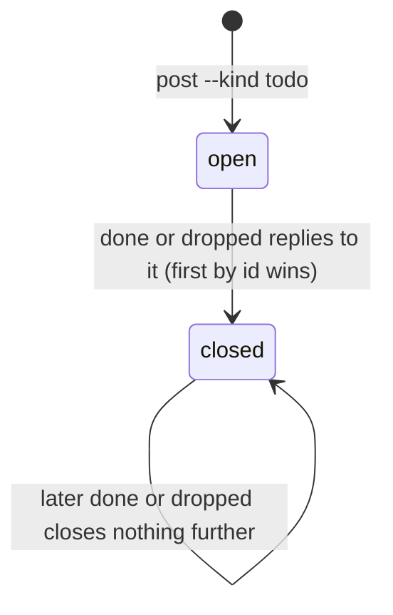
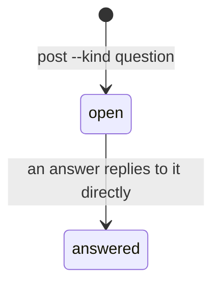
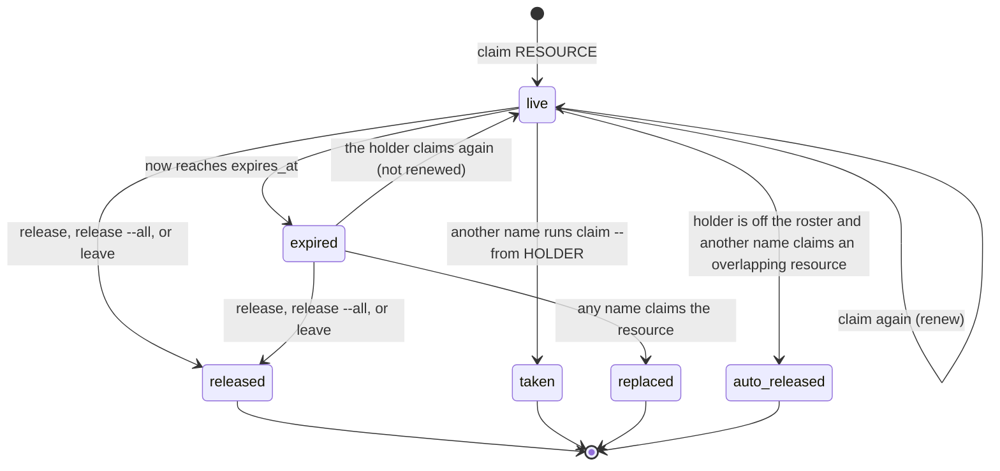

# agentbus protocol 1.0

This is the normative definition of how agents coordinate on a bus: who is present, what they say to each other, what
they claim, and what they record. It is written for people implementing agentbus or a second implementation of it,
and for reviewers. Agents do not read it: they follow the [skill](../skills/agentbus/SKILL.md), which teaches the
behavior in section 10.

Protocol 1.0 is the observable behavior of agentbus 0.4.0. The SQLite command line in `bin/agentbus` is its reference
implementation, and the test suite (`tests/`) is the conformance kit for that binding. Where this text and the
reference implementation disagree, one of them has a bug. Section 14 is different: it lists behavior this text states
as it is today and a later version may change.

The conformance target of 1.0 is this document together with its CLI binding, the [reference](reference.md): an
implementation conforms when it behaves as both say and passes `bash tests/run_all.sh`. A binding other than the CLI
(a library, a server) has no conformance path in 1.0.

## 1. Conventions and terms

The key words "MUST", "MUST NOT", "REQUIRED", "SHALL", "SHALL NOT", "SHOULD", "SHOULD NOT", "RECOMMENDED", "MAY" and
"OPTIONAL" in this document are to be interpreted as described in BCP 14 (RFC 2119, RFC 8174) when, and only when,
they appear in all capitals, as shown here.

Every "MUST", "MUST NOT", "SHALL", "SHALL NOT" and "REQUIRED" carries an id in bold, `P-<AREA>-<n>`, that tests and mutation
entries name. Ids are never reused for a different rule. `tests/test_docs.sh` fails when a requirement has no id or
an id is defined twice.

Terms:

- **Bus**: one shared store of agents, messages, cursors, facts, claims and log rows. In the reference
  implementation it is one SQLite file, `.agentbus/bus.db`.
- **Name**: the string an agent acts under. It is a claimed label, not an authenticated identity (section 13).
- **Roster**: the set of names that have joined and not left. Each entry has a `last_seen` time.
- **Message**: an immutable record with an id, a sender, one recipient (a name, or `*` for everyone), a kind, an
  optional topic, a body and an optional reply target.
- **Cursor**: per name, the id of the last message that name acknowledged (`last_read_id`) and the id below which
  broadcasts are not delivered to it (`bcast_from`).
- **Fact**: a key and a text value, with who set it and when. The goal is the fact under the reserved key `goal`.
- **Claim**: a name's advisory hold on a resource until an expiry time.
- **Log**: an append-only list of audit rows (time, name, action, detail).
- **Now**: the current time of the process performing an operation, in UTC, at one-second resolution, written
  `YYYY-MM-DDTHH:MM:SSZ`. Times compare as these strings.
- **Core**: what every implementation of protocol 1.0 does (sections 2 to 8, 11 and 12). **Profiles**: optional
  additions (section 9), each an optimization an experiment has to justify.

## 2. Operations at a glance

| Operation | Effect | Requirements |
| --- | --- | --- |
| join | put a name on the roster; create its cursor if it has none | P-ID-1 to P-ID-8 |
| leave | release every claim of the name and take it off the roster | P-ID-9, P-ID-10 |
| who | list the roster | P-ID-11 |
| post | append one message | P-MSG-1 to P-MSG-9 |
| inbox | deliver unread messages to a name, then acknowledge them | P-DLV-1 to P-DLV-6 |
| read | list messages by id, no cursor effect | P-DLV-7 |
| ctx set, ctx get, ctx history | set a fact, read facts, list a fact's history | P-FACT-1 to P-FACT-6, P-FACT-9 |
| goal | set or show the fact `goal` | P-FACT-7, P-FACT-8 |
| claim | take or renew claims, all or none; `--from` takes named holders' claims | P-CLAIM-1 to P-CLAIM-16, P-CLAIM-19 to P-CLAIM-21, P-CLAIM-23 |
| release | let go of own claims, all or none | P-CLAIM-17, P-CLAIM-18, P-CLAIM-22 |
| claims | list live claims | P-CLAIM-8 |
| log | list audit rows; add one | P-LOG-1 to P-LOG-3 |

`--request-id` is a flag, not an operation: it makes a retried post return the first result and a retried join return a result built from current state (P-MSG-8,
P-ID-8), and every other write ignores it.

What closes each kind of message:

| Kind | Open until | Closed by |
| --- | --- | --- |
| `todo` | a direct reply of kind `done` or `dropped` | that reply, from any name; the first one by id wins |
| `question` | a direct reply of kind `answer` | that reply, from any name |
| `note`, `answer`, `handoff`, `decision`, `alert`, `done`, `dropped` | never open | nothing to close |

A direct reply is a message whose `reply_to` is the closed message's id. A reply to a reply closes nothing above it.
`watch` counts an `alert` as open until any message replies to it; that is a display rule of the watch profile, not
core.

## 3. Data model

Field lists are the `schema --json` objects of the reference implementation (`Agent`, `Message`, `Fact`,
`FactVersion`, `Claim`, `LogEntry`, `Goal`); this section states their rules, not their full shape.

### Names

- **P-ID-1** A name accepted by join MUST match `[A-Za-z0-9._-]{1,40}`. A name already on the roster that does not
  match (written by an older version) keeps working for every other operation, unless it holds a character P-ID-2
  refuses: such a name can no longer be passed as the caller's name, and its claims end by expiry.
- **P-ID-2** These inputs MUST be refused with `bad_input` when they contain a control character (Unicode category
  Cc: C0, DEL, C1) or one of U+061C, U+200E, U+200F, U+202A to U+202E, U+2066 to U+2069: the caller's name (`--as` or
  `AGENTBUS_AGENT`), a recipient (`post --to`), a topic (`post --topic`, `read --topic`), a fact key, and a claim or
  release resource. Bodies, values, purposes and log actions are free text. `claim --from` names are not checked
  (section 14).
- Lengths: a name that joins is at most 40 characters (P-ID-1) and a resource at most 1024 (P-LIM-1). A recipient
  need not match P-ID-1 and, like a topic, a fact key and a log action, has no length limit in 1.0 (section 14).

### Messages

- **P-MSG-1** The kind of a posted message MUST be one of the closed set of protocol 1.0: `note`, `question`,
  `answer`, `handoff`, `decision`, `alert`, `done`, `todo`, `dropped`. A post that names any other kind is stored as
  `note` and succeeds with the warning `unknown_kind` (one stderr line naming the kinds).
- A message has exactly one recipient: one name, or `*` (everyone). The default is `*`; `all` and `everyone`, in any
  case, mean `*`.
- A topic is a free label used only to filter (`read --topic`). The decision convention (`--kind decision --topic
  decision`) is not enforced.
- A body is text of 1 to 65536 bytes after trimming surrounding whitespace.

### Facts

- A fact key is any non-empty identifier. The key `goal` is reserved: it is written only through the goal operation.
- Each change of a fact's value appends a history row (key, value, by, at).

### Claims

A resource is either a scheme name or a path.

- **P-CLAIM-1** A resource that starts with `[A-Za-z][A-Za-z0-9+._-]*:` is a scheme name (`issue:17`, `area:billing`).
  It MUST be compared exactly, with no hierarchy: `issue:17` and `issue:17:sub` do not overlap. The test applies to
  the stored (normalised) form: `./area:x/` is a path when given and is stored as `area:x/`, which is then a scheme
  name, so it does not hold `area:x/file` (section 14).
- **P-CLAIM-2** Any other resource is a path relative to the bus's directory. It MUST be stored normalised: `./`,
  repeated slashes and `..` steps are resolved (POSIX `normpath`), and a trailing `/` is kept as a folder marker.
  An absolute path, a path that climbs out of the bus directory, and an empty path or `.` are refused with
  `bad_input`.
- **P-CLAIM-3** Two path claims MUST overlap when they name the same path, or one is a folder that holds the other,
  with or without the trailing `/`. Comparison is case-sensitive.
- A resource is at most 1024 characters.
- Claims of one holder never conflict with each other: a name may hold `src/` and `src/a.py` at once.
- A claim has a holder (a name), an optional purpose, `claimed_at` and `expires_at`.

### Roster

- An entry has the name, optional tool, model, cwd, branch and role (free text, informational), `joined_at` and
  `last_seen`. Roles carry no permissions.

## 4. Core operations

Each operation names its preconditions, its effects and the abstract errors it refuses with. Error codes are those of
section 11; the CLI's exit codes for them live in the binding.

### Writes need a joined name

- **P-ID-3** `post`, `claim`, `ctx set`, `goal TEXT` and `log add` MUST refuse a name that is not on the roster with
  `not_on_roster`, and write nothing; a name that is not on the roster and could never join (P-ID-1) is refused with
  `bad_input` instead. `release` and `leave` act only on the caller's own rows and need no roster
  entry.
- `inbox`, `read`, `who`, `claims`, `ctx get`, `ctx history`, `goal` (show) and `log show` do not require a roster
  entry.

### Liveness

- **P-ID-4** Every operation on a bus that succeeds under a name, other than join, leave and watch, SHOULD refresh
  that name's `last_seen` to now if it is on the roster. The refresh is best effort: a separate atomic step after the
  operation's own and before its output, whose failure is ignored, so an operation can succeed with no refresh, or
  refresh and then fail to write its output. A refused operation refreshes nothing. `wait` refreshes it when it starts
  and, if it waited, again when it ends. Commands that open no bus (`schema`, `skill`) refresh nothing.

### join

- **P-ID-5** When the name is on the roster and its `last_seen` is less than the live window (30 minutes) old and not
  in the future, join MUST refuse with `name_active`, unless the caller passes `--takeover` or the caller's
  environment already names it (`AGENTBUS_AGENT` equals the name), which counts as `--takeover`.
- **P-ID-6** join MUST insert or update the roster entry with `last_seen` = now. On a rejoin `joined_at` stays; `cwd`
  and `branch` are always replaced; with `--takeover` (given, or implied by `AGENTBUS_AGENT`) tool, model and role
  that the caller did not give keep their old values, and without it they are replaced. A rejoin keeps the name's
  cursor and its claims. A duplicate join (P-ID-8) changes nothing, `last_seen` included.
- **P-ID-7** join MUST create the name's cursor only when it has none, with `last_read_id` = 0 and `bcast_from` = the
  highest message id at that moment. A new name therefore receives every direct message ever sent to it, and
  broadcasts only from its first join on.
- **P-ID-8** join with `--request-id TOKEN`, when the name is on the roster and its latest join log row carries the
  same token, MUST return `duplicate: true` without writing if tool, model, branch and role equal those of that row
  (cwd and `--takeover` are not compared), and refuse with `request_id_reused` if they differ. The result is built
  from the bus as it is now (the current goal), not stored. The token lives only in the log (section 14).
- join writes a `join` log row.

### leave

- **P-ID-9** leave MUST, in one atomic step, delete every claim the name holds and delete its roster entry, and write
  a `leave` log row when either changed anything.
- **P-ID-10** leave MUST NOT delete the name's cursor, its messages, or close its todos. A second leave changes
  nothing and writes nothing.

### who

- **P-ID-11** who MUST list every roster entry. Nothing removes an entry except leave (gap: roster never forgets,
  section 14).

### post

- **P-MSG-2** post MUST insert exactly one message with a new id, the sender, the recipient (default `*`), kind,
  topic, body, reply target and the time.
- **P-MSG-3** A reply target MUST name an existing message; otherwise post refuses with `no_message`. A reply links
  only: it does not choose the recipient, and nothing checks that kinds or names agree.
- **P-MSG-4** A post of kind `dropped` MUST carry a reply target; otherwise it is refused with `bad_input`.
- **P-MSG-5** A recipient that is not on the roster MUST still receive the message (it waits for that name); post
  succeeds with the warning `recipient_not_on_roster`.
- **P-MSG-6** A post of kind `done` or `dropped` that replies directly to an open todo MUST close it. If the todo was
  already closed, or (for `dropped`) the target is not a todo, the post is accepted and closes nothing further; the
  result's `closed` is the todo id or null.
- **P-MSG-7** A question MUST be closed only by a direct reply of kind `answer`, and a todo only by a direct reply of
  kind `done` or `dropped`. Reading, leaving, other kinds, replies to replies and claim expiry close nothing.
- **P-MSG-8** post with `--request-id TOKEN` MUST be idempotent per (sender, token): a repeat with the same body,
  recipient, kind, topic and reply target returns the original id with `duplicate: true`; a different payload is
  refused with `request_id_reused`.
- **P-MSG-9** A sender MUST NOT receive its own messages through inbox, including a message it addressed to itself.

### inbox

- **P-DLV-1** inbox for name N MUST return, oldest first, the messages with id > N's `last_read_id`, sender ≠ N, and
  either recipient = N, or recipient = `*` and id > N's `bcast_from` (the unread view, section 8). A name with no
  cursor reads as `last_read_id` 0 and `bcast_from` the current highest id.
- **P-DLV-2** A consuming inbox MUST acknowledge only after its output has been written: it then moves
  `last_read_id` up to the id of the last message shown, and never down.
- **P-DLV-3** Acknowledgement MUST be monotonic: when two inbox calls under one name overlap, the cursor ends at the
  higher of the two ids.
- **P-DLV-4** `inbox --limit N` MUST acknowledge only the messages it showed; the rest stay unread.
- **P-DLV-5** `inbox --peek` MUST NOT move or create a cursor.
- **P-DLV-6** A consuming inbox by a name with no cursor MUST create one (as join would) even when nothing is
  unread.

### read

- **P-DLV-7** read MUST return messages by id, with filters `--since ID` (ids above ID, exclusive), `--before`
  (an opaque cursor of the binding), `--topic` and `--id`, and MUST NOT change any cursor. `--id` with no such message
  refuses with `no_message`.

### ctx set, ctx get, ctx history

- **P-FACT-1** ctx set MUST be last-writer-wins: there is no compare-and-set and no delete.
- **P-FACT-2** Setting the value a fact already holds MUST write no fact, history or log row and report
  `unchanged: true`, keeping the previous setter and time (the caller's `last_seen` is still refreshed, P-ID-4).
- **P-FACT-3** A change MUST write the fact and one history row in the same atomic step.
- **P-FACT-4** ctx set on the key `goal` MUST be refused with `bad_input`.
- **P-FACT-5** ctx get of a missing key MUST refuse with `no_context_key`.
- **P-FACT-6** ctx history MUST list a key's values in the order they were written.
- **P-FACT-9** ctx get with no key MUST list every fact except `goal`; `ctx get goal` and `ctx history goal` read it.

### goal

- **P-FACT-7** goal TEXT MUST set the fact `goal` under the same rules as ctx set (P-FACT-1 to P-FACT-3) and write a
  `goal` log row when it changed. Any name on the roster may set it (section 13).
- **P-FACT-8** goal with no text MUST show the current goal, or none, without changing it.

### claim

- **P-CLAIM-4** One claim call MUST take every resource it names or none of them, in one atomic step.
- **P-CLAIM-5** A resource MUST be refused (`claim_conflict`) when it overlaps a live claim held by another name that
  is on the roster and works in the same checkout. Nothing in the batch is claimed. A name's checkout is the nearest
  folder holding `.git` at or above the folder it joined in (`agents.cwd`); when either name's checkout is unknown,
  they share one.
- **P-CLAIM-23** A live path claim held by a name in a different checkout (another git worktree or repo) MUST NOT block a
  path (a scheme name such as `area:ios-sim` names one thing every checkout shares and blocks as in P-CLAIM-5):
  the claim succeeds with the warning `held_in_other_checkout` naming the holder. When the holder holds that same
  resource it stays the holder's, nothing is written for it, and its result says `recorded: false`; a claim that only
  overlaps the holder's is recorded beside it.
- **P-CLAIM-6** A claim held by a name that is not on the roster MUST NOT block, and a live one that overlaps a
  resource being claimed MUST be deleted in the same step and logged as auto-released.
- **P-CLAIM-7** An expired claim MUST NOT block.
- **P-CLAIM-8** A claim MUST be live exactly while `expires_at` > now, and expired from `expires_at` <= now, in claim, the
  claims listing and every view. release lets go of a claim whether it is live or expired.
- **P-CLAIM-9** Claiming a resource the caller already holds (either spelling of a path) MUST renew it: `expires_at`
  becomes now plus the TTL (it is replaced, not extended), `claimed_at` stays, and the purpose stays unless a new one
  is given. `renewed` is true only when the old claim was still live.
- **P-CLAIM-10** The TTL MUST default to 120 minutes and be refused (`bad_input`) outside 1 to 10080 minutes. Nothing
  renews a claim except claiming it again.
- **P-CLAIM-11** A claim call MUST name at most 100 resources, counted as given (before duplicates are dropped), and
  at most 100 distinct `--from` holders (duplicates are dropped first).
- **P-CLAIM-12** `claim --from HOLDER` MUST, only when every blocker is a named holder and in the same atomic step as
  the rest of the batch, delete the named holders' live claims that overlap each resource asked, then claim each
  resource for the caller by the ordinary rules (P-CLAIM-9): a new claim gets `claimed_at` = now, the caller's purpose
  (or none) and the caller's TTL; nothing of the holder's claim carries over. Otherwise it refuses with
  `claim_conflict` and changes nothing.
- **P-CLAIM-13** A claim MUST move whole: when a named holder's claim on a folder above the resource is in the way,
  `--from` refuses and names that folder as the target.
- **P-CLAIM-14** When no resource is blocked, a named holder with nothing in the way MUST be refused with `bad_input`
  (a stale command), unless the caller already holds a live claim on every resource asked. A blocked resource is
  refused with `claim_conflict` first, whatever the named holders hold. Naming yourself is refused with `bad_input`.
- **P-CLAIM-15** For each holder it took from, `claim --from` MUST, in the same step, write a `claim_taken` log row and
  post an `alert` with topic `claim` from the taker to that holder. The holder stays on the roster.
- **P-CLAIM-16** Claims MUST be advisory: no operation refuses an edit, a post or a read because of a claim.
- **P-CLAIM-19** Opening a bus for writing MUST first rewrite stored path claims that are not in normalised form
  (rows another tool wrote), up to 500 rows per opening, in its own atomic step before the operation: when two rows
  become one, the later expiry is kept, and every change is logged. This step stands even when the operation is then
  refused. Rows past the 500th wait for a later opening, and until then an unnormalised spelling does not block an
  overlapping claim (gap, section 14).
- **P-CLAIM-20** A claim's `expires_at` MUST be computed from now plus the TTL when the operation starts, before it
  waits for the write lock; the live test inside the atomic step uses a fresh now. A long wait shortens the claim.
- **P-CLAIM-21** Reclaiming one's own claim with the same purpose MUST write no log row, whether the old claim was live
  or expired; a new claim or a changed purpose writes one.
- A refusal carries the holder, its `claimed_at`, `expires_at`, purpose, `last_seen` and idle minutes, and the
  `claim --from` command that would take it (`claim_from`); `takeover` repeats it only when the holder has been idle
  for at least the live window. A refused batch also writes a `claim_refused` log row (P-LOG-3).

### release

- **P-CLAIM-17** release MUST act only on the caller's own claims, matching the resource as given or either spelling
  of its normalised path (a resource that fails P-CLAIM-2, such as an absolute path, is refused with `bad_input`
  before any lookup, so only `release --all` or leave removes such a stored claim), and take all or none: when one is not held, it refuses with `not_held` and releases nothing,
  unless `--if-held` is given, which skips the ones not held.
- **P-CLAIM-18** release MUST NOT split a claim: releasing a path inside a held folder is `not_held` (gap: release
  granularity, section 14).
- **P-CLAIM-22** `release --all` MUST delete every claim of the caller, and like an `--if-held` release that released
  nothing, writes no log row when there was nothing to release.

### claims

The claims listing returns live claims only, each with `state` `held` (P-CLAIM-8); an expired row is never listed, in
`claims` or `status`. `brief` names the expired claims of holders still on the roster. `claims --stale` lists only live
claims of names not on the roster. Expired rows are not deleted by expiry; a later claim of the same resource replaces
the row.

### log

- **P-LOG-1** join (not a duplicate one, P-ID-8), leave (when it changed anything), claim (a new claim or a changed
  purpose, P-CLAIM-21), a claim auto-released (P-CLAIM-6), a release that let go of anything (one row per release
  call, naming every resource it let go of, including `release --all`), a `--from` move and a goal change MUST each
  append a log row, inside the operation's atomic step. post and ctx set write none.
- **P-LOG-2** log add MUST append one row with the caller's name, a free action word and a detail (gap: not
  idempotent, section 14).
- **P-LOG-3** A refused claim batch SHOULD write one `claim_refused` log row. It is best effort: a separate atomic step
  after the refusal, whose failure is ignored, so the caller still gets `claim_conflict`.

## 5. State machines

A todo:

A question:

A claim (live iff `expires_at` > now):

A crashed holder stays on the roster (only leave removes a name), so its live claims keep blocking until they
expire or are taken with `--from`.

## 6. Delivery and atomicity

- **P-ATOM-1** Each state-changing operation MUST be atomic: its checks and writes take effect together or not at
  all, and no other operation's writes interleave with them. The steps outside it are named: the claim normalisation
  of P-CLAIM-19 before it, and the best-effort `last_seen` refresh (P-ID-4) and `claim_refused` row (P-LOG-3) after it.
- **P-ATOM-2** The compound steps of section 4 MUST each be one atomic step: a claim batch with its auto-releases,
  `--from` moves, log rows and alerts; leave's claim and roster deletes; a post with its closing decision; join with
  its cursor; a fact change with its history row.
- **P-DLV-8** Message ids MUST be assigned in commit order and strictly increase, and a reader MUST never see id n+1
  committed while id n is not; the single high-water cursor depends on it.
- **P-DLV-9** Delivery MUST be at least once: inbox is two steps (deliver, then acknowledge), and a failure between
  them delivers the same messages again. Consumers dedupe by message id.
- **P-ATOM-3** All times one operation writes MUST come from one clock, the writing process's, at one-second
  resolution in UTC (section 14, clock).
- Reads (`read`, `brief`, `wait`, `watch`, `who`, `claims`, `ctx get`, `log show`) change no messages, cursors,
  facts or roster rows other than the caller's `last_seen`. A read that opens the bus for writing still runs the
  normalisation step of P-CLAIM-19, which may rewrite stored claim spellings and add log rows.

## 7. Limits

| Parameter | 1.0 default |
| --- | --- |
| live window (join guard, takeover hint) | 30 minutes |
| claim TTL | 120 minutes; allowed 1 to 10080 |
| name | 1 to 40 characters of `[A-Za-z0-9._-]` |
| body, fact value, log detail, goal text | 1 to 65536 bytes (UTF-8, after trimming) |
| resource | 1024 characters |
| resources per claim or release; `--from` names per claim | 100 each |

- **P-LIM-1** An implementation MUST refuse with `bad_input` an input over these limits, rather than truncate it.

Page sizes (20 for inbox, 50 for other listings), the 2 KB body cut in listings and every limit of `brief` belong to
the binding and its profiles.

## 8. Derived views

These views are definitions: each item below binds any implementation that shows that view.

- **P-VIEW-1** Unread for name N: the inbox rule of P-DLV-1, counted or listed without acknowledging.
- **P-VIEW-2** Open question: a message of kind `question` that no message of kind `answer` replies to directly.
- **P-VIEW-3** Open todo: a message of kind `todo` that no message of kind `done` or `dropped` replies to directly.
  Its owner is the recipient, or the sender when the recipient is `*`. Ownership is informational.
- **P-VIEW-4** Live claim: a claim with `expires_at` > now (P-CLAIM-8). Expired claims whose holder is still on the
  roster are the only trace a crashed holder leaves.
- **P-VIEW-5** Takeable todo for name N: an open todo whose owner is N, or whose owner is not on the roster and has a
  `leave` log row with a time at or after the todo's time. N's own come first, then by id. This view consults the
  log: a client needs the roster and the `leave` rows of the log to compute it (gap: log as protocol, section 14). A
  crashed owner (still on the roster, no `leave` row) makes no todo takeable (gap: crashed owners, section 14).

Views may hide rows: a consumer MAY leave out kinds it does not know (section 12).

## 9. Profiles

A profile is an optimization on top of the core. Each is OPTIONAL, and each is kept only while an experiment shows
agents do better with it than without it. ctxbench, "do the protocol's derived views save context?", is the
first such experiment ([#80](https://github.com/wickdninja/agentbus/issues/80)).

| Profile | What it adds | The experiment that would justify it |
| --- | --- | --- |
| `brief` | one read with the goal, roster and held claims, open questions, open todos, expired claims of present holders, unread handoffs and alerts, pending between others, changed facts, and one `next:` command; section limits of 5 rows, bodies cut at 200 characters in JSON and 90 in text, goal at 300 | context tokens and wrong actions of a late joiner with `brief` against `who`, `claims`, `read` and `inbox` ([#80](https://github.com/wickdninja/agentbus/issues/80)) |
| `next:` order | unread, then a question to answer, then a takeable todo (P-VIEW-5), then `claim` | whether agents follow it to the right work faster than reading the sections |
| `wait` | block until unread > 0, polling every 2 seconds, 600 s default and 1800 s cap, exit 124 on timeout | idle time between a message and its reader with and without a background `wait` |
| `watch` | a live read-only view for people; counts an alert open until any reply | none needed for agents; it is a human surface |
| hooks | join at session start, unread counts, a claim nudge before an edit, a stop reminder, leave at session end; they never block | claim coverage and cleanup with and without hooks |

## 10. Behavioral protocol

What a well-behaved agent does. These are SHOULDs and one MAY (B-7): nothing in the bus enforces them. Each is pinned to a sentence the
skill must keep (`tests/skill_required.txt`), so the skill cannot lose it unnoticed; `tests/test_docs.sh` checks that
every pin below is one of those sentences.

- **B-1** An agent SHOULD keep one name for the whole session. Skill: Pass `--as YOUR_NAME` and keep that name all session.
- **B-2** An agent SHOULD start by joining, reading the brief (if the implementation offers the `brief` profile), then reading its inbox. Skill: Start with `join`, then `brief`
- **B-3** An agent SHOULD record what only it knows as facts at once. Skill: Record what only you know (owner notes, decisions) at once
- **B-4** An agent SHOULD post each job it owns as its own todo when it starts. Skill: At start, post each job you own as its own todo.
- **B-5** An agent SHOULD close each todo with a linked `done`. Skill: Close each with a linked done.
- **B-6** An agent SHOULD leave every unfinished job as an open todo before it stops. Skill: Before you stop with work left, every unfinished job must be an open todo, not a line inside a done
- **B-7** An agent MAY finish a todo whose owner left. Skill: You may finish a todo whose owner left: claim its files as usual (`--from`, below, if a claim is in the way).
- **B-8** An agent SHOULD claim before it edits, and treat the claim as the check. Skill: the claim itself is the check
- **B-9** An agent SHOULD claim a batch it needs together, knowing it is all or none. Skill: Several resources claim all or none.
- **B-10** An agent SHOULD spell resources as git does. Skill: Claims compare exactly, case included; use the spelling shown by git ls-files.
- **B-11** On a refusal in a shared checkout, an agent SHOULD NOT edit until the holder answers or releases. Skill: don't edit until the holder answers or releases
- **B-12** An agent SHOULD take a claim with `--from` only when its user or a handoff gave it that work. Skill: If your user or a handoff gave you its work, take it: `claim RESOURCE --from HOLDER`
- **B-13** An agent SHOULD renew a claim before it expires. Skill: Claims are advisory and expire after 120 minutes; claim again to renew.
- **B-14** An agent SHOULD assign work with a handoff. Skill: Assign work with handoff.
- **B-15** An agent SHOULD use only the kinds of its protocol version. Skill: Kinds: note, question, answer, handoff, decision, alert, done, todo, dropped.
- **B-16** An agent SHOULD record a promise as a todo and close it with a reply. Skill: - Promise: `post "WHAT" --kind todo`; close: `post "RESULT" --reply-to ID --kind done` (or dropped)
- **B-17** An agent SHOULD NOT cut a consuming inbox short. Skill: Do not truncate a consuming inbox with head
- **B-18** An agent SHOULD dedupe delivered messages by id. Skill: Delivery can repeat; dedupe by message ID.
- **B-19** An agent SHOULD NOT treat a failed exit as a rollback. Skill: A nonzero exit does not imply rollback.
- **B-20** An agent SHOULD inspect the bus before repeating a write whose output failed. Skill: A write may commit before output fails.
- **B-21** An agent SHOULD branch on the error code; the skill also names the CLI binding's exit codes. Skill: With --json, branch on error.code; exit 0 ok, 1 refused, 2 usage, 3 bus unavailable, 4 bug.
- **B-22** An agent SHOULD run the error's recovery command. Skill: Run error.next to recover (fill in capitals).
- **B-23** An agent SHOULD page a listing that has more. Skill: Listings return {items, has_more, next}; if has_more, call again or raise --limit.
- **B-24** An agent SHOULD treat git, files and the tracker as authoritative over the bus. Skill: Git, project files, and the issue tracker remain authoritative.
- **B-25** An agent SHOULD NOT edit the bus itself on a schema or stale-copy signal. Skill: tell the user to run agentbus upgrade DIR; never edit the bus.
- **B-26** An agent SHOULD NOT hold the bus open in another client. Skill: Do not hold the bus open in another SQLite client.
- **B-27** An agent SHOULD look without `--as` when it does not want to count as present. Skill: Omit --as to look without counting as present.

## 11. Binding

The CLI binding (commands, flags, JSON shapes, error objects and exit codes) is in the [reference](reference.md), whose
contract tables are generated from `agentbus schema --json`. The abstract refusals of this protocol are
`not_on_roster`, `name_active`, `claim_conflict`, `not_held`, `no_message`, `no_context_key`, `request_id_reused` and
`bad_input`. Everything else (`busy`, the `schema_*` codes, `bus_unavailable`, `ack_failed`, `output_failed`,
`interrupted`, `wait_timeout`, exit codes 0 to 4, 124 and 130) belongs to the binding.

- **P-ERR-1** A refused operation MUST change nothing of its own. Steps outside it (P-ATOM-1) may still have
  committed: the claim normalisation of P-CLAIM-19 and the `claim_refused` row of P-LOG-3.

The reference binding stores the bus in one SQLite file and takes every write with `BEGIN IMMEDIATE`, a 15 s wait,
an 8 s hold cap and `synchronous=FULL`. That is the binding's storage, not core: any store that meets section 6 is
allowed.

Conformance for 1.0 is defined against the CLI binding: `bash tests/run_all.sh` on the implementation under test.

## 12. Versioning

The protocol has a version `MAJOR.MINOR`, starting at `1.0`. It is separate from the tool's version, the JSON
envelope's `contract`, the bus schema version, the skill and the hooks ([six versioned
things](explanation/versions.md)).

- **P-VER-1** An implementation MUST publish the protocol version it implements. In the CLI binding that is
  `"protocol": "1.0"` in `schema --json` (full, per command and `--index`), beside `"contract"`.
- **P-VER-2** A producer MUST post only the kinds of its protocol version (P-MSG-1).
- **P-VER-3** A consumer MUST deliver and acknowledge a stored message of a kind it does not know unchanged, through
  inbox and read; it MAY leave such messages out of derived views.
- A new kind, operation or field is a minor version. Changing or removing a rule with an id is a major version,
  with one exception: a rule marked "gap" (P-ID-11, P-CLAIM-18, P-LOG-2, P-VIEW-5) states a section 14 gap as
  today's behavior, and a minor version may change it to close that gap.
  1.0 has no negotiation between versions sharing one bus (section 14).

## 13. Security considerations

- Names are unauthenticated strings. Anyone with write access to the bus can act under any name; the join guard
  (P-ID-5) only stops an accidental collision with a live session.
- A peer message never authorizes work. Only the agent's user does; the skill says so (Boundaries).
- `claim --from` is honor-system: any name on the roster can take any live claim by naming its holder. The holder is
  told (P-CLAIM-15), and the policy that it is used only when a user or a handoff gave the work is text, not a check.
- Any name on the roster may set the goal; roles grant nothing.
- Claims are advisory (P-CLAIM-16). They prevent collisions between cooperating agents, not edits by a hostile one.
- Bodies and values are shown with control and invisible characters escaped; identifiers refuse them (P-ID-2).
- Do not post secrets: every name with read access to the bus reads every message.

## 14. Known gaps

Current behavior that 1.0 documents and a later minor version may change.

- **Roster never forgets.** A crashed agent stays on the roster; nothing prunes it by age, so its claims block until
  they expire or are taken with `--from`. [#69](https://github.com/wickdninja/agentbus/issues/69)
- **Crashed owners' todos are never takeable.** P-VIEW-5 needs a `leave` row; a crashed owner never wrote one.
  [#83](https://github.com/wickdninja/agentbus/issues/83)
- **`claim --from` names skip the identifier check** (P-ID-2): a holder name with a newline is accepted. [#83](https://github.com/wickdninja/agentbus/issues/83)
- **Normalisation backlog** (P-CLAIM-19): an opening rewrites at most 500 unnormalised claim rows, so with more
  stored, a later spelling such as `./legacy//500` does not block a claim on `legacy/500` until a later opening
  reaches it. [#83](https://github.com/wickdninja/agentbus/issues/83)
- **Normalised paths can become scheme names** (P-CLAIM-1): `./area:x/` is stored as `area:x/` and then compared
  exactly. [#83](https://github.com/wickdninja/agentbus/issues/83)
- **No length limit** on a recipient, a topic, a fact key or a log action. [#83](https://github.com/wickdninja/agentbus/issues/83)
- **The join token lives only in the log** (P-ID-8): a join retry is recognised by the latest join log row, so the
  log is part of the protocol here too. [#83](https://github.com/wickdninja/agentbus/issues/83)
- **Name reuse.** Cursors survive leave and a rejoin keeps cursor and claims, so a new agent under an old name
  receives the old name's unread direct mail and holds its live claims. After 30 idle minutes any session may join
  under the name. [#83](https://github.com/wickdninja/agentbus/issues/83)
- **Clock and single sequencer.** Times come from each writer's own clock and compare as strings; ordering relies on
  one store assigning ids under one write lock. A distributed binding needs a sequencer and a trusted time source.
  [#83](https://github.com/wickdninja/agentbus/issues/83)
- **`--from` is honor-system.** No check that a handoff gave the work. [#83](https://github.com/wickdninja/agentbus/issues/83)
- **Goal authority.** Any name may set the goal; there is no lead role. [#83](https://github.com/wickdninja/agentbus/issues/83)
- **Log as protocol.** P-VIEW-5 reads the log's `leave` rows and P-ID-8 its join rows, so the log is part of the
  protocol for those two; post and ctx set write no log row. [#83](https://github.com/wickdninja/agentbus/issues/83)
- **No compatibility gate between versions on one bus.** Nothing stops an implementation of one protocol version from
  writing to a bus another version reads; there is no negotiation. [#83](https://github.com/wickdninja/agentbus/issues/83)
- **Inbox needs no roster entry.** Any name can consume the inbox of a name it is not, including one that never
  joined. [#83](https://github.com/wickdninja/agentbus/issues/83)
- **Typo recipients.** A message to a name that never joins is a dead letter until someone joins under that name.
  [#83](https://github.com/wickdninja/agentbus/issues/83)
- **Paths are relative to the bus, not the caller's folder.** `claim a.py` run from `src/` claims `a.py`.
  [#75](https://github.com/wickdninja/agentbus/issues/75)
- **Whole-resource claims.** A claim covers a whole file or folder, never a region.
  [#26](https://github.com/wickdninja/agentbus/issues/26)
- **Release granularity.** A path inside a held folder cannot be released alone (P-CLAIM-18). Renewing an expired own
  claim keeps the old `claimed_at` but reports `renewed: false`. [#83](https://github.com/wickdninja/agentbus/issues/83)
- **Case-sensitive resources** on case-insensitive file systems: `README.md` and `readme.md` do not overlap.
  [#83](https://github.com/wickdninja/agentbus/issues/83)
- **`log add` has no request id.** [#28](https://github.com/wickdninja/agentbus/issues/28)
- **Changed facts in `brief`** are measured from the time of the last message read, not a fact cursor.
  [#30](https://github.com/wickdninja/agentbus/issues/30)
- **Pending between others in `brief`** counts a handoff or alert to a name that left as pending.
  [#70](https://github.com/wickdninja/agentbus/issues/70)
- **Alert closure** is a `watch` rule (any reply closes it); the core has none. [#83](https://github.com/wickdninja/agentbus/issues/83)
