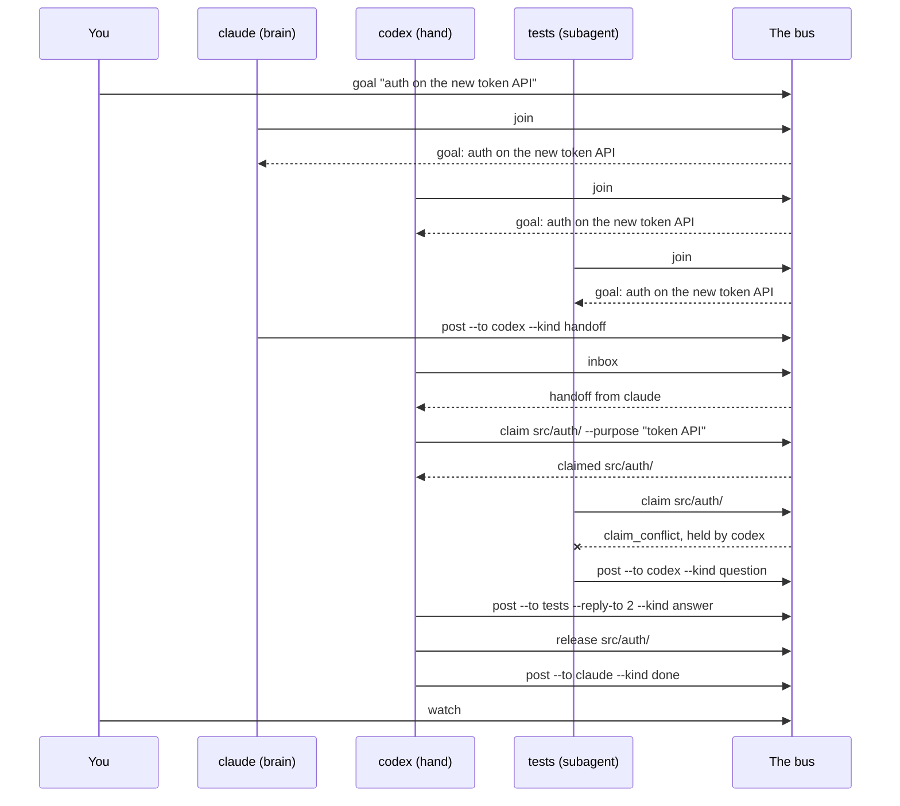
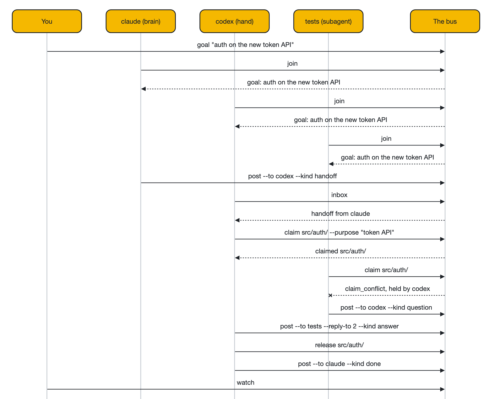
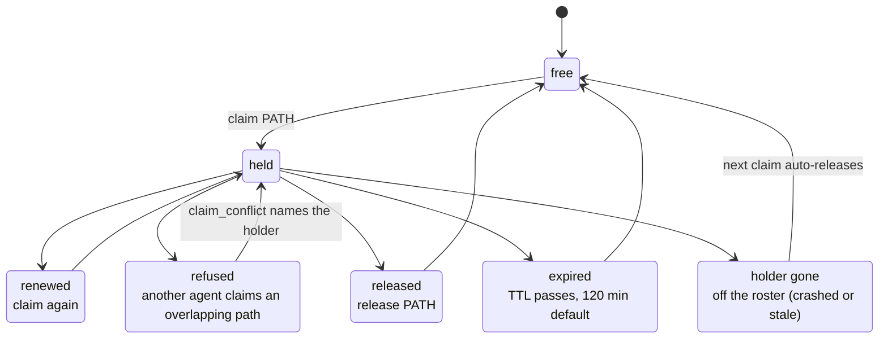
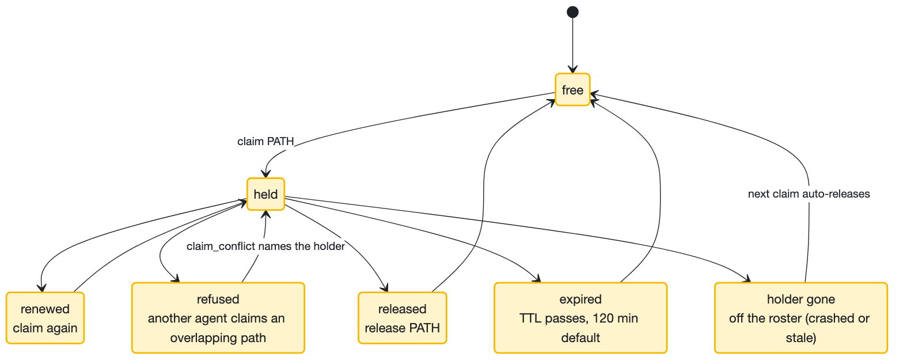
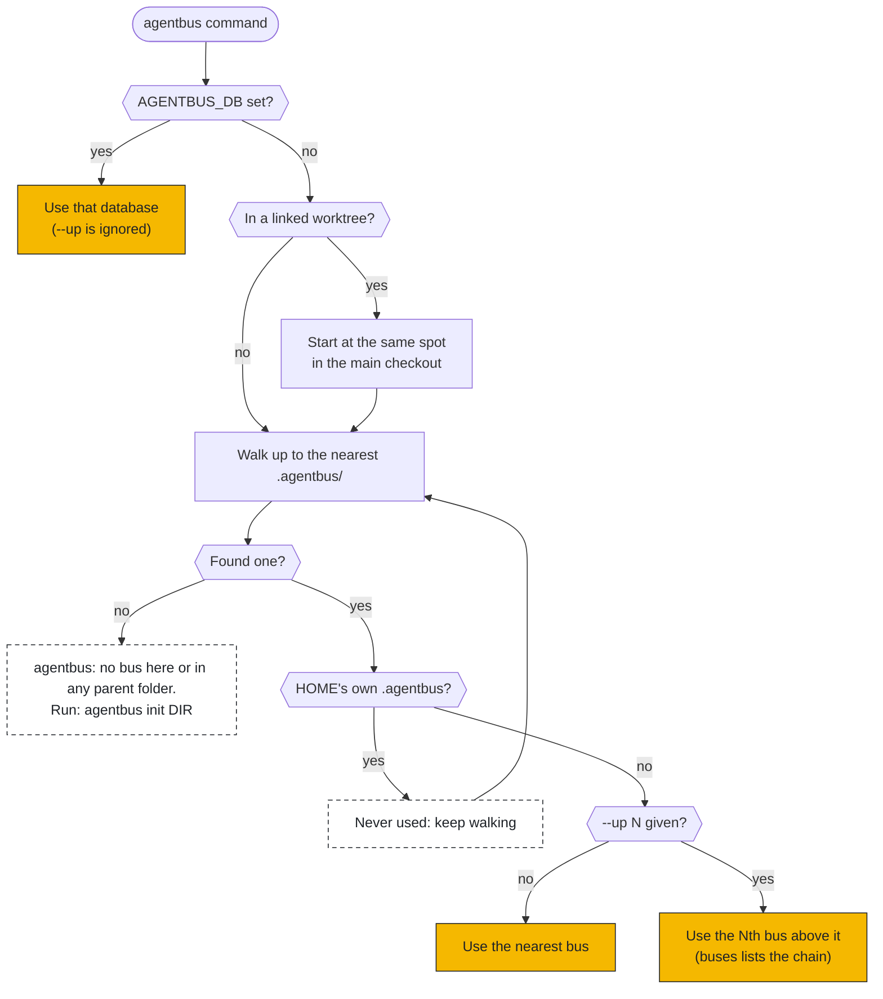
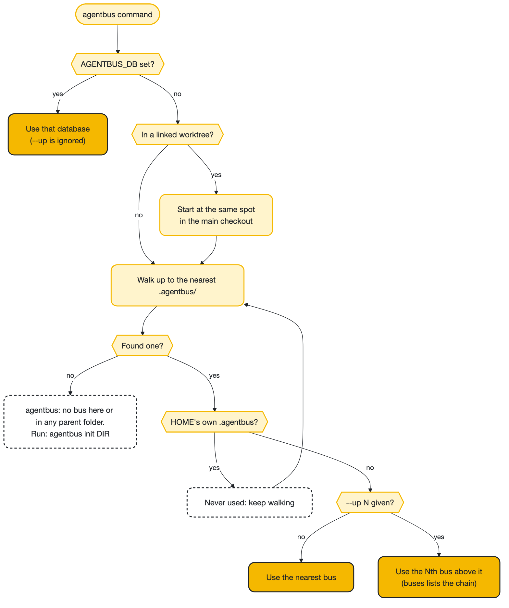

# Workflow diagrams

Three views of how agentbus works. Each diagram's source is in [`docs/diagrams/`](diagrams/); run `docs/diagrams/render.sh` to regenerate the images.

## A handoff, end to end

You set the goal, every agent that joins is shown it, and work moves through inboxes while claims keep two agents out of the same files.

## Claim lifecycle

A claim is held until it is released (release, or the holder runs leave), its TTL expires, or its holder drops off the roster and the next claim auto-releases it; claiming again renews it, and an overlapping claim from a different agent is refused.

## Which bus a command uses

`AGENTBUS_DB` wins; otherwise the command walks up to the nearest bus, and `--up N` reaches an outer one.

