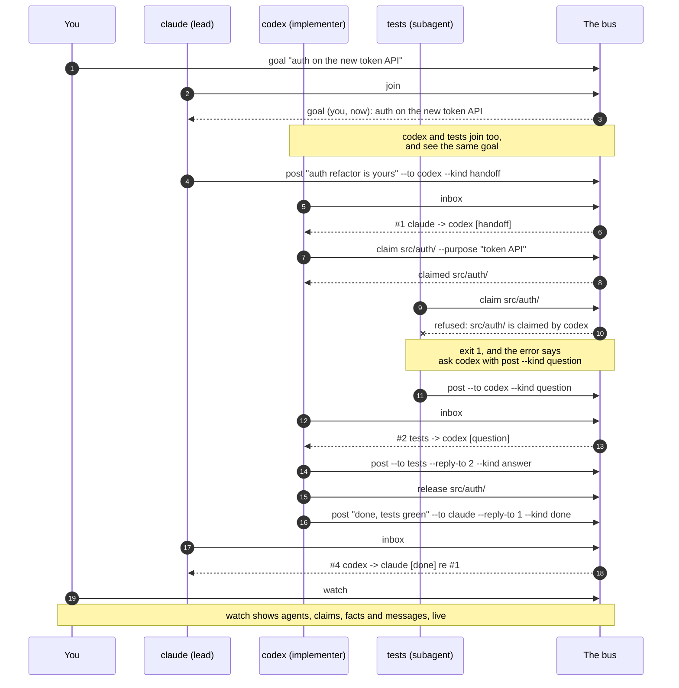
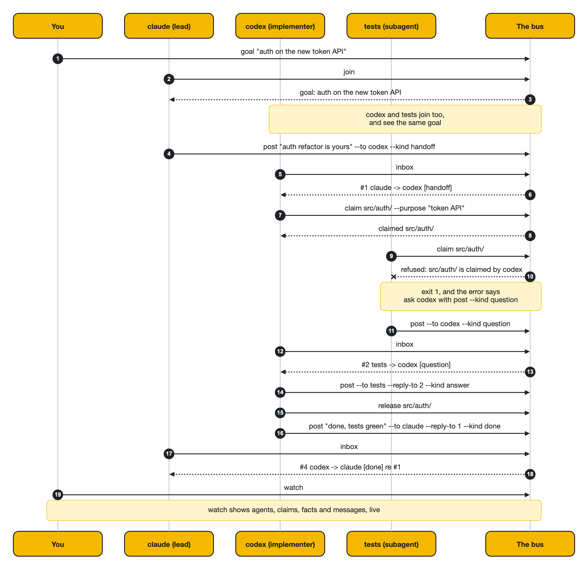
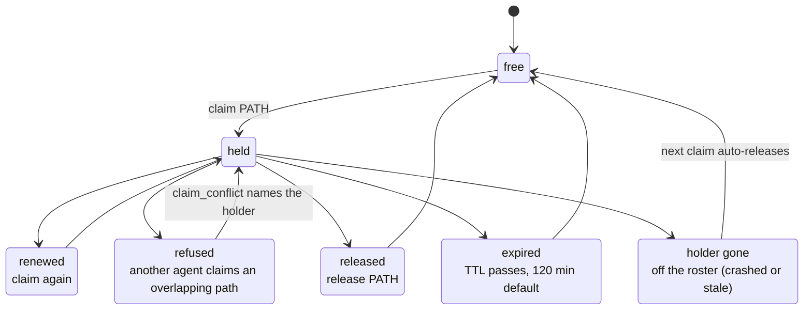
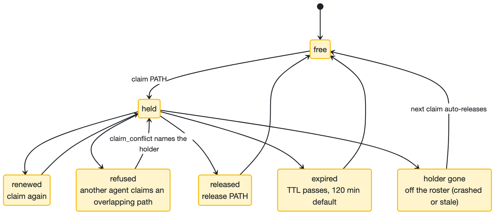
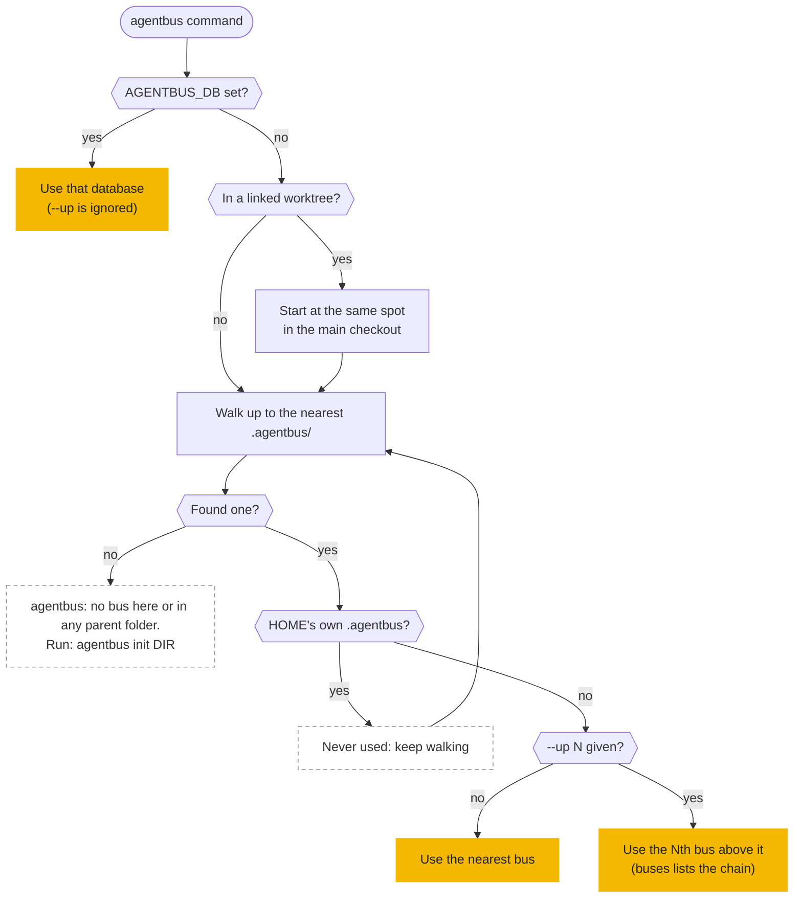
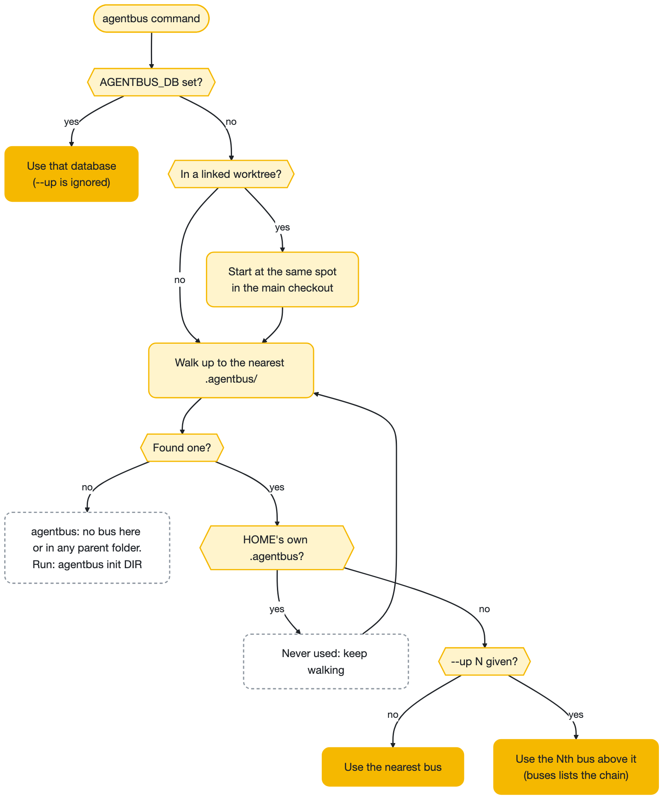

# Workflow diagrams

Three views of how agentbus works. GitHub renders each Mermaid block; the image under it is the same diagram, in your theme. Sources are in [`docs/diagrams/`](diagrams/); run `docs/diagrams/render.sh` to regenerate every image.

## A handoff, end to end

You set the goal, every agent that joins is shown it, and work moves through inboxes while claims keep two agents out of the same files. The dashed replies are what each agent sees: `inbox` prints `#1 claude -> codex [handoff]`, and a refused claim names the holder.

<picture>
  <source media="(prefers-color-scheme: dark)" srcset="diagrams/handoff-dark.png">
  
</picture>

## Claim lifecycle

A claim is held until it is released (release, or the holder runs leave), its TTL expires, or its holder drops off the roster and the next claim auto-releases it; claiming again renews it, and an overlapping claim from a different agent is refused.

<picture>
  <source media="(prefers-color-scheme: dark)" srcset="diagrams/claims-dark.png">
  
</picture>

## Which bus a command uses

`AGENTBUS_DB` wins; otherwise the command walks up to the nearest bus, and `--up N` reaches an outer one.

<picture>
  <source media="(prefers-color-scheme: dark)" srcset="diagrams/bus-selection-dark.png">
  
</picture>
